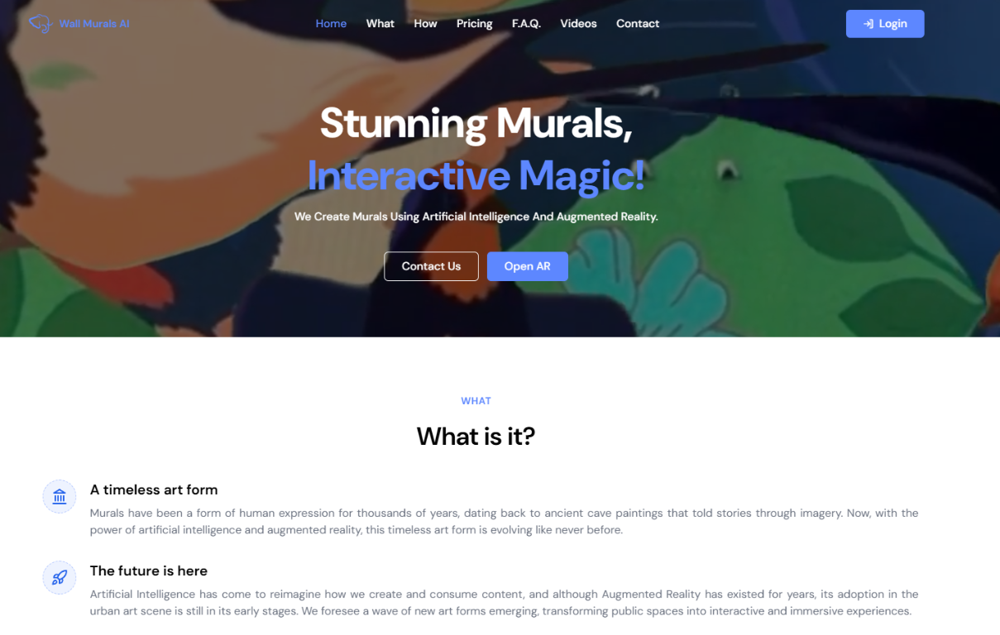

# Wall Murals AI

Wall Murals AI creates interactive murals that combine artificial intelligence,
augmented reality, and physical artwork. The platform can support the full
creative process—from mural design and painting through AR animation—or bring
an existing mural to life with an interactive digital layer.

AR experiences run in the cloud and require no app installation. Visitors scan
a QR code near the artwork, point a smartphone or tablet at the mural, and
watch digital content appear in the real world. They can capture photos and
videos, interact with animated content, and share the experience on social
media.

For brands and artists, each experience can include photos, video, audio,
logos, 2D and 3D animations, external links, calls to action, interactive
buttons, and other visual effects. The platform also provides engagement data
such as impressions, opens, captures, saves, and shares to help measure
campaign performance and return on investment.

Visit the live website at [wallmurals.ai](https://www.wallmurals.ai/).



## Features

- Browser-based augmented-reality experiences for murals
- QR-based experiences that work on smartphones and tablets without an app
- Interactive photos, videos, audio, logos, animations, links, and calls to action
- Social sharing and audience engagement around branded artwork
- Performance metrics for measuring impressions, opens, captures, saves, and shares
- Artwork and AR content management through a protected dashboard
- Account, subscription-plan, and usage-metrics pages
- MongoDB persistence
- Redis-backed sessions outside development
- EJS server-rendered views with Express

## How it works

1. **Scan the QR code** — Open the cloud experience directly in a mobile
   browser.
2. **Point at the mural** — The artwork acts as the image tracker for the AR
   content.
3. **Interact and capture** — View the animation, create a photo or video, and
   engage with calls to action.
4. **Share and measure** — Share the result on social media and review
   experience metrics to evaluate reach and engagement.

## Requirements

- Node.js and npm
- MongoDB
- Redis for non-development environments

## Getting started

1. Install dependencies:

   ```bash
   npm install
   ```

2. Create a `.env` file in the project root. At minimum, configure the
   database, session, and CSRF secrets:

   ```dotenv
   NODE_ENV=development
   PORT=3000
   MONGO_URI=mongodb://127.0.0.1:27017/wallmurals
   SESSION_KEY=replace-with-a-long-random-secret
   CSRF=replace-with-a-32-character-secret
   ```

   The application also reads site metadata, email, Cloudflare, usage-limit,
   and authentication settings from environment variables. Keep credentials
   out of source control; `.env` is ignored by Git.

3. Start the development server:

   ```bash
   npm run dev
   ```

   The server listens on `http://localhost:3000` by default. Set `PORT` to
   use another port.

## Available scripts

| Command | Description |
| --- | --- |
| `npm start` | Start the production server |
| `npm run dev` | Start the server with Nodemon |
| `npm run build` | Build and minify frontend assets with Gulp |

## Application routes

- `/` — Public website
- `/ar` — Augmented-reality experiences
- `/users` — Authentication and user account flows
- `/dashboard` — Artwork management and account administration
- `/metrics` — Public metrics/contact endpoints used by the application

AR experiences can be opened by route, artwork ID, or location. See
[`routes/ar.js`](./routes/ar.js) for the available endpoint shapes.

## Project structure

```text
app.js          Express application and middleware
bin/www         HTTP server entry point
controllers/    Request handlers
db.js           MongoDB connection
helpers/        Shared integrations and utilities
models/         MongoDB models
public/         Static assets and uploaded media
routes/         Express route definitions
views/          EJS templates
```

## Production notes

Set `NODE_ENV` to a value other than `development` in deployed environments.
The application then uses Redis for session storage and enables HTML
minification and response compression. Configure the Redis password with
`REDIS_PASS` and ensure the Redis service is reachable at the configured
deployment hostname.

Uploaded media and temporary files are intentionally excluded from Git. Back
up or persist `public/uploads/` and configure the required environment
variables through the deployment platform's secret manager.
